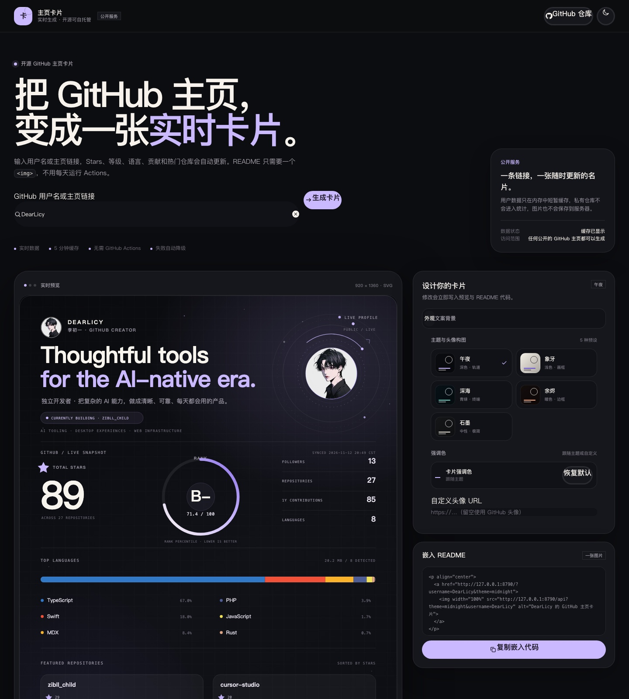
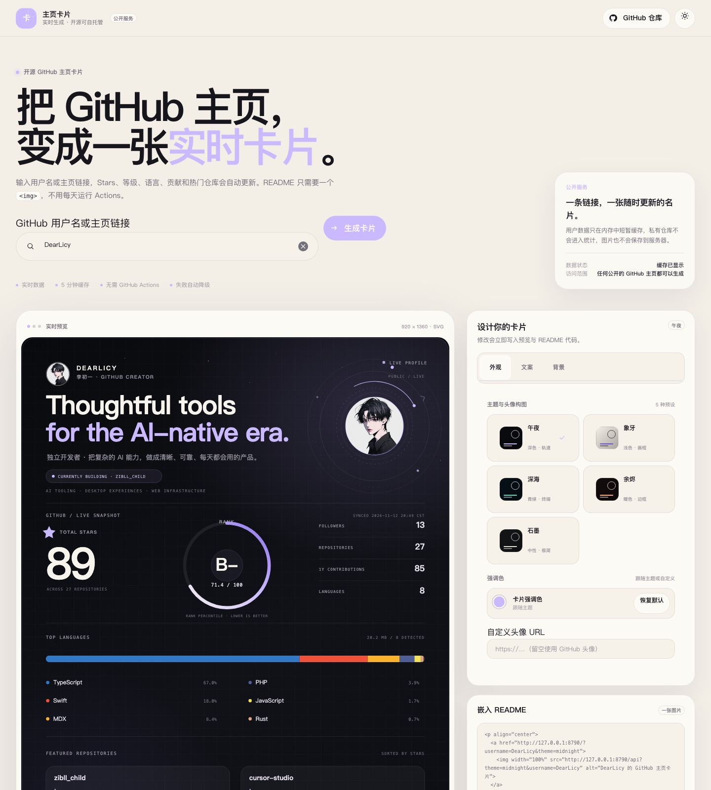
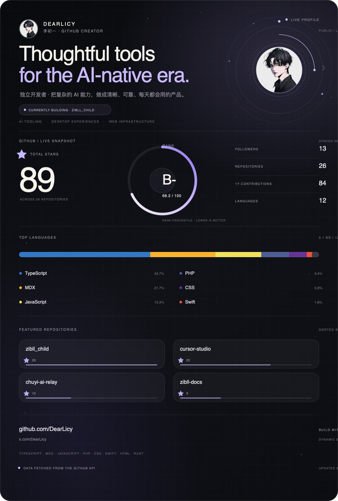
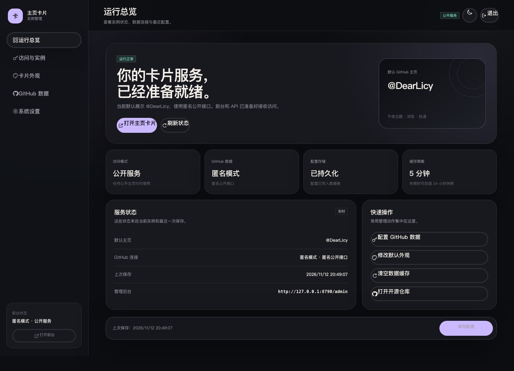
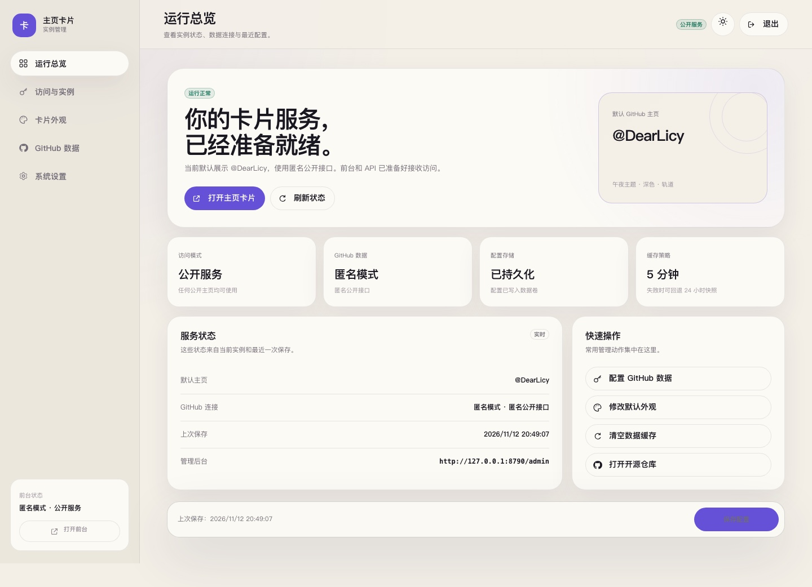
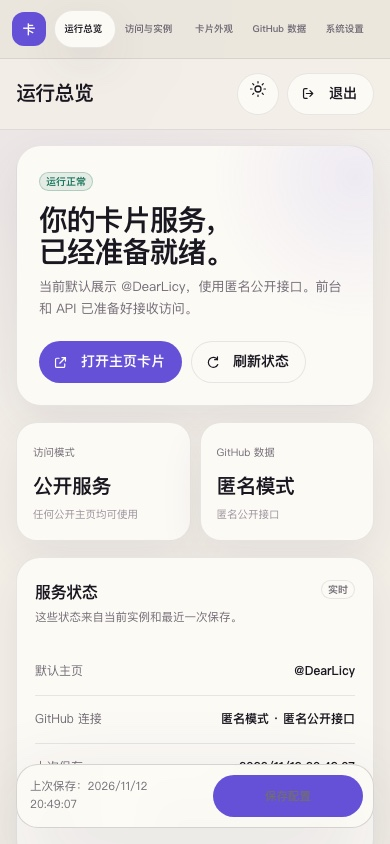

<p align="center">
  
</p>

<h1 align="center">主页卡片</h1>

<p align="center">
  输入 GitHub 用户名或主页链接，生成一张实时更新、可定制的动态 SVG 名片。<br>
  支持公开 API、自用模式、可视化编辑器与中文管理仪表盘。
</p>

<p align="center">
  <a href="https://profile.akucb.com/"></a>
  <a href="https://github.com/DearLicy/dearlicy-profile-card/stargazers"></a>
  
  
  
</p>

## 在线使用

打开 **[profile.akucb.com](https://profile.akucb.com/)**，输入用户名、`@用户名` 或完整 GitHub 主页链接即可生成。

卡片会自动读取公开的 Stars、等级与评分、Followers、Repositories、年度贡献、语言构成和热门仓库。README 只需要一张 ``，不需要 GitHub Actions 定时生成。

```html
<p align="center">
  <a href="https://profile.akucb.com/?username=YOUR_LOGIN">
    
  </a>
</p>
```

## 特点

- **一张动态卡片**：所有公开指标集中在一个 SVG 中，风格统一，自动刷新。
- **直接识别主页链接**：支持 `DearLicy`、`@DearLicy` 和 `https://github.com/DearLicy`。
- **五套视觉主题**：午夜、象牙、深海、余烬、石墨，对应不同构图、色彩与动效。
- **可定制内容**：强调色、头像、两行标题、简介、状态徽标、页脚备注和热门仓库展示。
- **外部背景图**：背景可引用 HTTPS 图片，不上传本服务；四个角支持独立透明度。
- **公开 API 与自用模式**：实例所有者可以开放给所有人，也可以只允许指定账号。
- **中文仪表盘**：访问模式、实例信息、默认外观、GitHub 连接、缓存维护分区管理。
- **组件化界面**：前后台均使用 Shoelace Web Components，不依赖浏览器原生表单外观。
- **可靠降级**：GitHub 暂时不可用时回退到 24 小时内快照；生成失败也返回完整错误卡，避免 README 破图。
- **自托管友好**：Docker、非 root、只读根文件系统、CSP、Origin 校验、加密凭据和自动证书续期均可配合使用。

## 预览

<table>
  <tr>
    <td width="50%"></td>
    <td width="50%"></td>
  </tr>
</table>

<p align="center">
  
</p>

## 管理仪表盘

访问 `/admin`，使用环境变量 `ADMIN_SECRET` 登录。

<p align="center">
  
</p>

<details>
<summary>查看浅色与移动端后台</summary>
<br>
<p align="center">
  
</p>
<p align="center">
  
</p>
</details>

## GitHub 数据连接

匿名 GitHub REST 接口通常只提供 **每小时 60 次请求**。如果实例需要更高额度，可在后台保存一条服务端只读 Token，将数据通道提升到 GraphQL，通常可获得 **每小时 5,000 次请求**。

这里推荐只读 Personal Access Token，而不是让访客登录 GitHub：

- 本产品读取的是公开数据，不存在“每位用户授权自己的账号”的必要。
- 不需要额外维护授权应用、Client Secret 和回调地址。
- 后台可测试当前连接，并显示正在使用匿名 REST 还是已配置的 GraphQL。
- 不配置 Token 也能正常运行，只是请求额度较低。

创建入口：

```text
https://github.com/settings/tokens/new?description=Profile%20Card%20(read-only)
```

本服务只需要读取公开信息，不需要私有仓库权限。令牌会使用由 `ADMIN_SECRET` 派生的 AES-GCM 密钥加密保存在 `data/config.json`，后台不会返回明文。

## API

| 路由 | 说明 |
| --- | --- |
| `GET /api` | 输出动态 SVG，单张卡片 |
| `GET /api/card`、`/card.svg`、`/profile.svg` | SVG 路由别名 |
| `GET /api/summary` | 卡片对应的 JSON 指标，开启 CORS |
| `GET /api/site` | 当前实例的公开模式、默认用户与主题元数据 |
| `GET /api/health`、`/health` | 健康检查 |
| `GET /admin` | 管理员仪表盘 |

### 查询参数

| 参数 | 示例 | 说明 |
| --- | --- | --- |
| `username` / `user` / `url` | `DearLicy` | GitHub 用户名、`@username` 或主页 URL |
| `theme` | `midnight` | `midnight`、`ivory`、`ocean`、`ember`、`graphite` |
| `accent` | `%23FFB07C` | 六位十六进制强调色，`#` 需要 URL 编码 |
| `bg` | `https%3A%2F%2F...` | HTTPS 背景图 |
| `photo` | `https%3A%2F%2F...` | 自定义头像 URL |
| `mark` | `DEARLICY` | 左上角标识，最多 24 字符 |
| `h1` / `h2` | `Designing+useful` | 两行标题，最多 42 / 48 字符 |
| `intro` | `Open+source...` | 简介，最多 120 字符 |
| `badge` | `BUILDING+NOW` | 状态徽标，最多 64 字符 |
| `note` | `KEEP+SHIPPING.` | 页脚备注，最多 64 字符 |
| `bgTL` / `bgTR` / `bgBR` / `bgBL` | `0.5` | 四角透明度，范围 0–1 |
| `refresh=1` | `1` | 跳过 5 分钟新鲜缓存，受 20 秒冷却限制 |

示例：

```bash
curl -o card.svg \
  'https://profile.akucb.com/api?username=DearLicy&theme=ocean&accent=%2365D6C4&bgTL=0.7&bgTR=0.2&bgBR=0.5&bgBL=0.1'
```

### 图片处理

- 已知图片主机（GitHub、Unsplash、jsDelivr、Imgur）会由服务端读取并转换为 data URI，兼容性更好。
- 其他 HTTPS 图片地址会直接嵌入 SVG；能否被 GitHub 图片代理加载，取决于目标站点的防盗链策略。
- 可通过 `ASSET_HOSTS` 追加允许服务端代理的域名，逗号分隔。
- 背景和头像不会持久化到数据卷。

### 缓存策略

- 同一 GitHub 用户的数据缓存 5 分钟。
- 并发刷新会合并为一次 GitHub 请求。
- GitHub 异常时可回退 24 小时内的成功快照。
- `refresh=1` 有 20 秒冷却。
- GraphQL 查询显式限制为公开仓库，私有代码不会进入统计。

## 自托管

### 环境要求

- Node.js 20+
- Docker 与 Docker Compose（推荐）
- 带 HTTPS 的反向代理

### Docker 启动

```bash
cp .env.example .env
openssl rand -hex 32
```

将随机值写入 `.env` 的 `ADMIN_SECRET`，按需填写 `GITHUB_TOKEN`，然后：

```bash
mkdir -p data
sudo chown -R 1000:1000 data
docker compose up -d --build
curl http://127.0.0.1:3410/health
```

Compose 默认只监听 `127.0.0.1:3410`。请通过 Nginx、Caddy 或 Cloudflare Tunnel 对外提供 HTTPS。

仓库包含 [`deploy/nginx.conf`](deploy/nginx.conf)。反向代理至少需要：

```nginx
proxy_set_header Host $host;
proxy_set_header X-Forwarded-Proto $scheme;
proxy_set_header X-Forwarded-Host $host;
proxy_set_header X-Real-IP $remote_addr;
```

### 备份

需要备份的是 `data/config.json`。其中包含实例配置和加密后的凭据；恢复时必须继续使用相同的 `ADMIN_SECRET`，否则旧凭据无法解密。

## 本地开发

```bash
npm install
cp .env.example .env
# 编辑 .env，至少设置 ADMIN_SECRET
npm run dev
```

打开 `http://127.0.0.1:3410/`。不配置 `GITHUB_TOKEN` 时会自动使用匿名公开 REST。

```bash
npm test
```

生成一个不经过 HTTP 服务的 SVG：

```bash
GITHUB_USERNAME=DearLicy GITHUB_TOKEN="$(gh auth token)" npm run render
```

## 项目结构

```text
src/
  index.js            HTTP 路由与公开 API
  github.js           GitHub GraphQL / REST 数据层
  profile-service.js  内存与 Cache API 缓存
  card.js             动态 SVG 渲染
  page.js             前台编辑器
  ui.js               共享页面资源、图标和组件配置
  admin.js            管理员鉴权与配置 API
  admin-page.js       中文管理仪表盘与登录页
  config.js           主题、布局与卡片参数
  site-config.js      实例配置与访问模式
  assets.js           外部图片处理
server/
  site-store.mjs      文件持久化与加密凭据
server.mjs            Node HTTP 入口与组件静态资源
```

## 环境变量

| 变量 | 必填 | 作用 |
| --- | --- | --- |
| `ADMIN_SECRET` | 是 | 管理员登录与凭据加密密钥，至少 24 字符 |
| `GITHUB_TOKEN` | 否 | 服务端只读 GitHub Token |
| `ASSET_HOSTS` | 否 | 允许服务端代理的其他图片域名，逗号分隔 |
| `SITE_MODE` | 否 | 首次启动的 `public` / `private` 默认值 |
| `DEFAULT_USERNAME` | 否 | 首次启动的默认 GitHub 用户 |
| `PUBLIC_REPO_URL` | 否 | 前台右上角 GitHub 按钮的目标地址 |
| `DATA_DIR` | 否 | 持久化目录，Docker 中为 `/app/data` |
| `PORT` / `HOST` | 否 | 监听端口与地址 |

后台保存的配置会覆盖 `SITE_MODE`、`DEFAULT_USERNAME` 和 `PUBLIC_REPO_URL` 的初始值。

## 安全与隐私

- 不请求、不统计、不展示私有仓库。
- GitHub Token 不会出现在 HTML、SVG、JSON、日志或 Git 中。
- 管理后台 Cookie 使用 `HttpOnly`、`SameSite=Lax`，HTTPS 下自动启用 `Secure`。
- 所有写操作校验 Origin，并带有登录尝试限速。
- Docker 容器以非 root 用户运行，丢弃 Linux capabilities，根文件系统只读，仅 `/app/data` 和 `/tmp` 可写。
- 公开实例仍应遵守 GitHub API 规则；大规模使用建议配置只读 Token，并在反向代理层增加限速。

安全细节见 [`SECURITY.md`](SECURITY.md)。

## License

[MIT](LICENSE) © 2026 DearLicy
